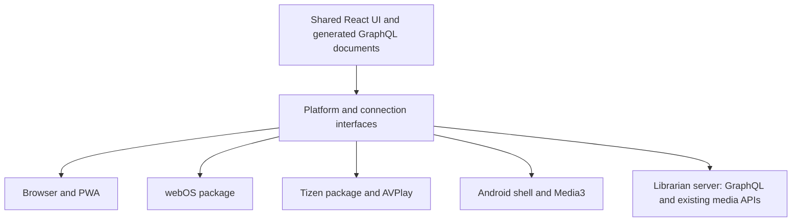

# TV applications implementation plan

Status: initial plan 2026-09-07; Android prototype added 2026-09-08. An Android debug package
now builds; physical TV compatibility and the other platforms are not qualified.
This document records proposed work; [design.md](design.md) remains
the architecture authority, including its authentication and GraphQL requirements.

## Android prototype progress — 2026-09-08

- Implemented [apps/android-tv](../apps/android-tv/README.md): a small Java/platform-API shell
  using the hosted frontend, native server selection, TV launcher assets, fullscreen WebView
  video, media keys, Back/menu behavior, and lifecycle handling.
- Selected hosted same-origin loading for this feasibility build to preserve current HttpOnly
  cookie authentication. Bundled assets and native Media3 playback remain future work; this
  experiment does not change the shared frontend or backend authentication contract.
- Built a debug APK with Gradle 8.11.1 / AGP 8.9.2 / JDK 17 / Android SDK 35. The app's install
  minimum is API 26; its frontend/WebView and playback compatibility still need device testing.
- Validation passed: debug APK assembly, three URL/origin unit tests, Android lint (no issues),
  APK signature verification, and TV launcher/manifest inspection. Builds used the shared
  `320000 100000` CPU quota on this four-CPU host. No physical TV or emulator has
  been used to qualify this build. Record model/firmware/WebView and the remote/playback test
  results when installing it using the [direct installation guide](../apps/android-tv/README.md#install-the-built-apk-on-your-tv).

This completes an initial Android packaging experiment, not either cross-platform feasibility gate.

## Objective and proposed scope

Build the existing `web/` frontend into installable applications for LG webOS TVs, Samsung
Tizen TVs, and Android TV / Google TV devices. Reuse the browsing experience, generated
GraphQL contracts, and playback state while adding platform-specific packaging and services.
The Rust backend continues running on the user's server; TVs connect to it as clients.

“Native application” here means an app installed and launched from the TV home screen, with
remote input, platform lifecycle handling, and access to platform playback facilities. The
proposed approach retains React for the UI. A fully native UI rewrite is a separate decision
if device testing shows the shared frontend cannot meet the required experience.

Proposed first release:

- Connect to a user-selected Librarian server, sign in, reconnect, and sign out.
- Browse movies and shows, search, view details and episodes, and continue watching.
- Play, pause, seek, resume, select supported audio/subtitle tracks, and save watch progress.
- Complete these journeys with only a standard D-pad remote.
- Recover from server/network outages and TV suspend/resume without losing the account context.

Music, audiobooks, acquisition/admin screens, offline media downloads, voice search, launcher
recommendations, and Cast receiver integration are follow-up scope. Existing browser features
remain supported. Cast support alone does not deliver an installable TV client.

## Current foundation and gaps

The implementation baseline is the Vite SPA documented in [web/README.md](../web/README.md).
`design.md` still names TanStack Start in its frontend stack section; reconcile that wording
when adopting the implementation architecture rather than introducing SSR for TV packaging.

| Area | Existing implementation | Work needed for installed apps |
| --- | --- | --- |
| Build | [vite.config.ts](../web/vite.config.ts): ES2022 output, code splitting, PWA generation | Target-specific assets, runtime compatibility, package metadata, and signing |
| Routing | [app/router.tsx](../web/src/app/router.tsx): browser routing and scroll restoration | History that works from a packaged entry point; native Back and deep-link handling |
| TV input | [input-mode.tsx](../web/src/lib/input-mode.tsx): TV detection, forced mode, geometric spatial focus | Platform key normalization, focus scopes/restoration, and remote-only qualification |
| UI | [STYLE_GUIDE.md](../web/STYLE_GUIDE.md), HeroUI 3, Tailwind 4, TV tokens | Engine compatibility, viewing-distance legibility, and measured rendering cost |
| Transport | [apollo/client.ts](../web/src/lib/apollo/client.ts): relative `/graphql`, WebSocket host from `window.location` | Runtime server selection for both HTTP and `/graphql/ws` |
| Assets/media | [api/urls.ts](../web/src/lib/api/urls.ts), [artwork.ts](../web/src/lib/artwork.ts) | Resolve local backend paths against the selected server, including returned playback URLs |
| Authentication | [auth/session.ts](../web/src/lib/auth/session.ts): HttpOnly cookies and renewal | Resolve packaged-origin/cookie constraints before committing to bundled UI |
| Playback | [useMediaSource.ts](../web/src/features/player/useMediaSource.ts): HTML media, hls.js, native HLS fallback | Platform player adapters and device-specific playback decisions |
| Progress | [useProgressSync.ts](../web/src/features/player/useProgressSync.ts): generated progress/session mutations | Feed native player events into the same progress flow; qualify suspend and recovery |
| Updates | [pwa.ts](../web/src/lib/pwa.ts): Workbox update flow | App-store/package updates independent of browser service workers |

## Platform strategy

There are three build families. Android TV applications also run on Google TV; test both
experiences, but keep one Android project. [Google TV guidance](https://developer.android.com/training/tv/get-started/google-tv)

| Target | Proposed application | Packaging and playback direction |
| --- | --- | --- |
| LG webOS | webOS web app using shared frontend | `.ipk`, `appinfo.json`, icons, webOS CLI; qualify HTML media/native HLS and webOS lifecycle APIs |
| Samsung Tizen | Tizen TV web app using shared frontend | Signed `.wgt`, `config.xml`, icons, TV privileges; evaluate AVPlay for production playback |
| Android TV / Google TV | Android app with shared React UI in WebView and a narrow native bridge | APK for device testing, AAB for Play distribution; evaluate Media3 ExoPlayer and MediaSession |

LG supports both packaged and hosted web applications. A bundled UI is the desired delivery
shape, but its authentication feasibility is an explicit gate below. The LG packaging workflow
uses its [web app model](https://webostv.developer.lge.com/develop/getting-started/web-app-types)
and [CLI](https://webostv.developer.lge.com/develop/tools/cli-introduction).
Samsung's packaging uses its [TV toolchain](https://developer.samsung.com/smarttv/develop/faq/tizen-studio.html);
[AVPlay](https://developer.samsung.com/smarttv/develop/api-references/samsung-product-api-references/avplay-api.html)
is the platform playback candidate, not an assumption that every model supports every codec.

For Android, prototype a small Kotlin shell first. Use
[WebViewAssetLoader](https://developer.android.com/develop/ui/views/layout/webapps/load-local-content)
for bundled assets and evaluate [Media3](https://developer.android.com/media/media3/exoplayer)
for playback. Serving local assets with an HTTPS-style origin does not make the remote
Librarian server same-origin. Select a wrapper framework only if the prototype demonstrates
that it reduces maintenance while preserving TV input, playback, and lifecycle behavior.

## Architecture and build changes

Proposed locations, to create during implementation:

- `web/src/platform/`: typed interfaces and browser, webOS, Tizen, and Android adapters.
- `web/src/lib/connection/`: selected server, URL resolution, connection status, and transport setup.
- `web/platforms/webos/` and `web/platforms/tizen/`: manifests, assets, and packaging inputs.
- `apps/android-tv/`: Gradle project, native bridge, lifecycle, and playback integration.
- `web/scripts/build-tv.mjs`: build orchestration using the existing generation pipeline.
- `web/dist-tv/<target>/`: separate output; retain `web/dist/` for the embedded server frontend.

Interfaces should cover runtime identity/capabilities, input, lifecycle, storage, and player
commands/events. Feature components must not import `webapis`, `tizen`, or Android bridge
globals directly. Keep input mode separate from platform identity: a desktop user selecting
TV mode must still use the browser adapter.

Proposed commands are `pnpm build:tv:webos`, `pnpm build:tv:tizen`, and
`pnpm build:tv:android`; these do not exist yet. Each should generate GraphQL documents/types,
typecheck, bundle for its supported engine, and stage assets. Keep signing as a separate
release step. Disable PWA registration and update prompts in packaged targets, and verify
lazy chunks, fonts, artwork placeholders, and workers load from their installed location.

Prefer hash history for packaged web entry points unless a platform-qualified local origin
supports browser history fallback. Map Android intents/platform launches into internal routes.
Test returning from nested routes and relaunching the app without a web server serving its UI.

## Gate 1: engine and UI compatibility

The current `es2022` build target is only one compatibility requirement. Tailwind 4 depends
on modern CSS, with Chrome 111 as its documented Chrome baseline.
[Tailwind compatibility](https://tailwindcss.com/docs/compatibility)

LG lists webOS 24 with Chromium 108 and webOS 25 with Chromium 120. Therefore, webOS 24 is
below that baseline; webOS 25 is a reasonable first compatibility candidate, not a support
guarantee. [LG engine matrix](https://webostv.developer.lge.com/develop/specifications/web-api-and-web-engine)
Select Samsung candidates against its [engine matrix](https://developer.samsung.com/smarttv/develop/specifications/web-engine-specifications.html).
Record Android OS and actual WebView provider/version separately.

Before choosing minimum model years:

- Render a representative shell, poster row, dialog, input, and player controls on each candidate.
- Audit emitted CSS and HeroUI behavior as well as JavaScript, modules, dynamic imports,
  workers, Web Locks, storage, and media APIs. Lowering the JS target cannot repair CSS support.
- Measure large poster lists, focus movement, image decoding, memory, and sustained playback.
- Add TV token-level fallbacks for expensive glass/refraction and ambient 3D where needed;
  retain the HeroUI/Tabler component system and update the style guide with adopted behavior.
- Choose between a modern-device baseline and a separately costed older-engine compatibility
  effort. Do not promise support for all LG or Samsung TVs.

Exit evidence: a device matrix with exact model, firmware, OS, engine, rendering results,
and proposed support status. Browser viewport tests alone do not qualify a TV runtime.

## Gate 2: server connection and authentication

An installed app must ask for a server address at runtime and remember the non-secret
connection preference. Start with manual URL entry; discovery and phone-assisted entry can
follow. Validate connectivity before sign-in, show actionable offline/certificate errors,
and allow changing servers. Define whether reverse-proxy subpaths are supported; either
preserve them consistently or reject them clearly. Never bake one user's server into releases.

Centralize GraphQL HTTP/WS URLs and all backend-relative asset/media URLs. Audit provider URLs,
subtitle URLs, HLS playlists/segments, and any absolute URLs returned by the server. On server
change, stop playback, dispose subscriptions, and clear account-scoped Apollo/cache state
before connecting elsewhere.

Authentication is a design dependency, not just a URL configuration change:

- The current [auth contract](authentication-security.md) uses HttpOnly access/refresh cookies
  with `SameSite=Lax` and origin checks. Cross-site browser deployments are unsupported.
- LG explicitly documents that packaged `file:` apps cannot use cookies; hosted HTTP(S) apps
  can. This blocks assuming the existing login flow will work in a bundled webOS app.
  [LG cookie restrictions](https://webostv.developer.lge.com/develop/specifications/web-api-and-web-engine)
- Qualify Tizen and Android separately. CORS allowlisting alone does not change SameSite
  behavior or establish authenticated playback in a native player.

Compare two concrete options during the prototype:

| Option | Benefit | Required evidence / tradeoff |
| --- | --- | --- |
| Hosted UI on the selected Librarian server | Closest to the existing same-origin cookie model | Package can launch it reliably; platform APIs and session persistence work; server availability and frontend updates become runtime dependencies; distribution rules permit this model |
| Bundled UI with an explicit device authentication contract | Versioned UI assets and local connection/offline screen | New design for credential issuance, rotation, revocation, storage, authenticated HTTP/WS/media, and any native bridge; adoption requires updating the authoritative auth design |

The second option is proposed work, not permission to expose existing refresh credentials to
JavaScript or URLs. Do not bypass origin checks, disable certificate verification, or reuse
legacy query-token behavior as the new TV auth design. Any pairing flow should use short-lived,
single-use codes authorized from an existing signed-in client, with expiry, attempt limits,
and device revocation. Pairing itself does not solve credential storage or media authorization.

Validate the chosen contract across GraphQL, subscriptions, artwork, direct media, range
requests, HLS playlists/segments, subtitles, and session renewal during playback. Native
players may not share the WebView cookie jar. Decide HTTPS and local HTTP support explicitly
against platform transport restrictions; preserve Librarian's local-server use case.

Exit evidence: sign in, browse, play beyond access expiry, suspend/relaunch, reconnect, revoke,
and sign out on each platform without credential leakage or weakened browser authentication.

## Remote input and TV experience

Extend the existing spatial navigation instead of creating a second UI implementation.
Normalize D-pad, Select, Back, Play/Pause, Stop, and seek actions at the platform boundary.
Samsung requires registration for additional remote keys and reports Back as `10009`;
LG's Back guide describes `461` and platform exit handling.
[Samsung remote input](https://developer.samsung.com/smarttv/develop/guides/user-interaction/remote-control.html),
[LG Back behavior](https://webostv.developer.lge.com/develop/guides/back-button)

Required behaviors:

- Predictable initial focus and focus restoration after route changes, dialogs, and playback.
- Scoped modal/menu focus, sensible poster-row boundaries, and recovery when a focused item
  disappears or a paginated row loads. Avoid scanning an unbounded DOM on every repeated key.
- Visible focus and actions without hover; text readable at normal TV viewing distance.
- Back closes the active overlay, then follows app navigation; at the root, delegate to the
  platform's expected exit behavior. Preserve OS-owned Home and system controls.
- Handle held keys without double actions; preserve text editing and slider key semantics.
- LG pointer/remote switching and Android soft keyboard submission work alongside D-pad input.
- Keep navigation visible through loading/errors; contain scrolling in the intended region.

## Playback and lifecycle

Introduce a player interface for load, play, pause, seek, track selection, stop, and disposal,
plus position, duration, buffering, completion, and error events. Keep the existing browser
player as the browser adapter and reuse progress/session operations for every engine.

The existing [media API](../backend/src/api/media.rs) chooses direct/remux/transcode using
browser-oriented compatibility predicates. Extend playback negotiation with validated client
capabilities before claiming broader TV codec support. Keep FFprobe authoritative and reuse
the existing FFmpeg/HLS path. Domain reads/writes must continue through the GraphQL entity
layer; any new capability/session operations belong there first, with generated documents.

Qualify these cases separately for each player:

| Area | Qualification cases |
| --- | --- |
| Baseline video | H.264/AAC MP4 direct play, compatible-codec remux, and forced HLS transcode |
| Seek and resume | Start offset, repeated seeks, growing HLS output, end-of-file, and resume on another client |
| Tracks | Audio language switching; supported text subtitles; explicit fallback for unsupported/image subtitles |
| Advanced media | HEVC, 4K, HDR variants, multichannel audio, and passthrough only where measured and declared supported |
| Failure | Unsupported format, missing FFmpeg, server restart, network interruption, expired/revoked session |
| Lifecycle | Background, suspend, wake, player-surface restoration, app termination, and resource cleanup |

Prefer native HLS on webOS only after comparison with hls.js on target devices. Evaluate
AVPlay surface placement/overlays on Samsung and Media3 surface/focus integration on Android.
Platform fullscreen and display power behavior require adapters; browser Fullscreen and
Media Session APIs cannot stand in for every TV integration.

Persist progress periodically and on pause/lifecycle events; sudden termination can prevent
a final request. Resume from confirmed saved progress, avoid duplicate playback sessions,
and bound reconnect/recovery loops. Log platform, app version, operation, and non-secret media
identifiers with failure context, following the repository logging rules.

## Delivery phases and acceptance gates

The Android prototype above is the first partial Phase 0 implementation. The phase gates below
remain open. Hardware/account access and the authentication
decision determine scheduling; no delivery dates or minimum OS promises are set yet.

| Phase | Deliverable | Completion gate |
| --- | --- | --- |
| 0 — Feasibility | Device inventory; minimal boot/render/input/auth/playback prototype for all three build families | Gates 1 and 2 resolved with measured results and a recorded architecture decision |
| 1 — Shared foundation | Runtime adapters, server selection, target build modes, routing and PWA separation | Browser regression checks pass; each installed shell boots and reaches its selected server |
| 2 — Remote browsing | Home, libraries, search, details, episode selection, focus restoration | All first-release browsing journeys complete with D-pad only |
| 3 — Playback | Browser/webOS/Tizen/Android player integration and shared progress | Baseline media matrix passes on hardware, including renewal, resume, and failure recovery |
| 4 — Device beta | Reproducible development packages, installation guides, diagnostics, compatibility matrix | Fresh install, upgrade, cold launch, suspend/resume, and extended playback pass on each supported device class |
| 5 — Distribution | Release signing, store assets, review instructions, update/support policy | Platform requirements checked, review builds tested, and submissions prepared |

Start Phase 0 on an available modern device from each family. Once feasibility is established,
use the first passing device for the full browsing-to-playback integration, then qualify the
other adapters against the same contract. An Android-only success cannot close webOS/Tizen gates.

## Testing, packaging, and release operations

- Add focused unit/component tests for input mapping, focus restoration, server URL handling,
  lifecycle transitions, and player event/progress integration. Use existing generated mocks.
- Extend Playwright D-pad journeys against the disposable sandbox, including errors and
  reconnects. Capture screenshots at 1080p and 4K layouts; actual device output must also be checked.
- Record real-device model/firmware/player results and measure cold launch, input response,
  playback startup, dropped frames, and memory. Set numeric release budgets after Phase 0
  establishes repeatable hardware/network fixtures.
- Run a proposed two-hour playback soak per supported platform and repeat suspend/wake,
  account revocation, and server switching. Record pass/fail evidence, not just installation success.
- Keep SDK versions, manifests, package IDs, versions, and signing identities reproducible.
  Store certificate/keystore secrets outside git; preserve signing identity for upgrades.
- Document LG developer-mode installation separately from consumer distribution, Samsung
  certificate/device setup, and Android APK installation separately from Play AAB submission.
- For Android, include TV launcher metadata, banner/icon assets, no required touchscreen,
  native media/lifecycle behavior, and current SDK/store requirements in the release checklist.
  [Android TV setup](https://developer.android.com/training/tv/get-started/create),
  [TV app quality](https://developer.android.com/docs/quality-guidelines/tv-app-quality)
- Prepare LG/Samsung/Google store listings and a reviewer-accessible test server/account.
  Check current review, privacy, content, and hosted-code requirements before submission.
  A development package is not evidence of store acceptance.
- Record minimum compatible backend version and handle mismatches clearly; installed clients
  can lag server releases. Define upgrade recovery and supported-version policy before release.
- Follow repository workflow: use `web/live.sh` for the live frontend; do not start the backend
  with `cargo run`. Cap all concurrent build/compiler/linker work at an aggregate 80% CPU quota.

## Decisions to fill in next

| Decision | Initial position | When to resolve |
| --- | --- | --- |
| Exact devices and minimum model/OS versions | Modern candidates first; no supported floor yet | Phase 0 |
| Bundled versus hosted UI and auth contract | Prefer bundled delivery if compatible with the adopted security design | Phase 0, before transport implementation |
| Android shell | Java/platform-API hosted WebView prototype built; Media3 evaluation pending | Phase 0 |
| Older TV engines | Separate compatibility effort if required | After rendering probe |
| Distribution priority and regions | Developer-device beta before store releases | Before Phase 4 |
| HTTP LAN and reverse-proxy subpaths | Explicitly evaluate both; no silent compatibility assumptions | Phase 0 |
| Music/audiobooks and broader feature parity | Follow movie/show playback milestone | After Phase 3 |

Immediate next work: identify available LG, Samsung, and Android/Google TV test devices,
record their runtime versions, and build the three minimal feasibility probes. Keep results
and the resulting decisions in this document so later implementation tasks have concrete gates.
